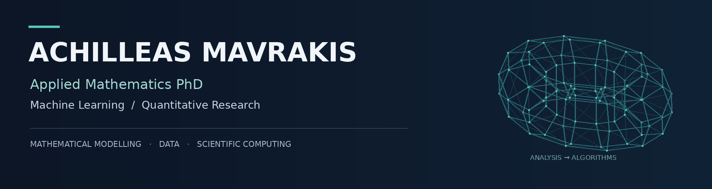

  

  <a href="#about">About</a> &nbsp; · &nbsp;
  <a href="#selected-projects">Projects</a> &nbsp; · &nbsp;
  <a href="#research">Research</a> &nbsp; · &nbsp;
  <a href="#technical-toolkit">Skills</a> &nbsp; · &nbsp;
  <a href="https://www.linkedin.com/in/achilleas-mavrakis/">LinkedIn ↗</a>

## About

I completed a PhD in Computational and Applied Mathematics at the **University of Warwick**, specialising in numerical analysis, optimisation, and scientific computing. My research develops and analyses numerical methods for fluid problems on stationary and evolving surfaces.

Alongside my research, I build statistical and machine-learning models for financial data, with particular interests in **prediction in low signal-to-noise settings, time-series analysis, and robust validation**.

| Research | Machine learning | Independent projects |
| :--- | :--- | :--- |
| **3 research papers** on numerical methods for surface fluid problems | **Top 3% in two QRT × ENS ML challenges** — stock returns and electricity prices | Options trading, backtesting, and training-label horizon selection |

## Selected projects

### [Stock Return Prediction ↗](https://github.com/AchillesMavr/Machine-Learning-Challenge-Stock-Return-Prediction)

**QRT × ENS Data Challenge · Top 3% · 47 / 1,600+**

Predicting residual US stock returns from **418k+ observations** of historical returns and relative volumes. The pipeline combines lag, rolling, technical, and sector-level features with rank IC-based feature selection and tree ensembles.

`Python` `pandas` `scikit-learn` `LightGBM` `CatBoost`

---

### [Systematic BTC Options Trading ↗](https://github.com/AchillesMavr/BTC-Options-Trading-Algorithm)

**Independent project · Pricing, hedging, and backtesting**

A systematic options strategy and backtesting pipeline using **three years of Deribit data**. The work covers volatility forecasting, option pricing, Greek computation, and dynamic delta hedging through perpetuals.

`Python` `SQL` `Time-series modelling` `Options` `Delta hedging`

---

### [Training-Label Horizon Optimisation ↗](https://github.com/AchillesMavr/Label-Horizon-Optimization-Paradox)

**Independent research · Financial forecasting**

Investigating how the training-label horizon affects forecasts when the prediction horizon stays fixed. On a **synthetic asset panel**, an Optuna-based bilevel search selects horizon weights and evaluates label mixtures using out-of-sample cross-sectional correlations.

**Synthetic-data results:** Pearson IC **0.378 → 0.390** · Rank IC **0.345 → 0.358**.

`Python` `LightGBM` `Optuna` `Chronological splits` `Purge gaps`

## Research

**Numerical Analysis for Fluid Problems on Stationary and Evolving Surfaces**  
PhD, University of Warwick

I combine mathematical analysis with computational experiments to study surface Stokes and Navier–Stokes problems. My work includes an evolving surface finite element solver, a custom quasi-Newton method, and visualisation of meshes and solution fields in ParaView.

**Selected papers**

- [SFEM for the Lagrangian Formulation of the Surface Stokes Problem](https://doi.org/10.1093/imanum/draf120) — C. M. Elliott & A. Mavrakis, *IMA Journal of Numerical Analysis*.
- [A Fully Discrete Surface Finite Element Method for Navier–Stokes on Evolving Surfaces](https://arxiv.org/abs/2512.11737) — C. M. Elliott & A. Mavrakis, preprint.
- [SFEM for the Unsteady Navier–Stokes Equations on a Stationary Surface](https://arxiv.org/abs/2508.09266) — C. M. Elliott & A. Mavrakis, preprint.

**Research presentations:** ENUMATH 2025 · 30th Biennial Numerical Analysis Conference · Oberwolfach.

## Technical toolkit

| Area | Tools and methods |
| :--- | :--- |
| **Programming** | Python, SQL, R, Java, Fortran, MATLAB, Git, Linux |
| **Data & machine learning** | NumPy, pandas, SciPy, scikit-learn, LightGBM, CatBoost, PyTorch, Optuna |
| **Statistics & forecasting** | Statistical modelling, feature engineering, cross-validation, ARIMA, GARCH, NLP |
| **Scientific computing** | Finite elements, numerical linear algebra, optimisation, Firedrake, Gmsh, ParaView |

---

  <a href="https://www.linkedin.com/in/achilleas-mavrakis/">Connect on LinkedIn</a> &nbsp; · &nbsp;
  <a href="https://github.com/AchillesMavr?tab=repositories">Explore my repositories</a>

